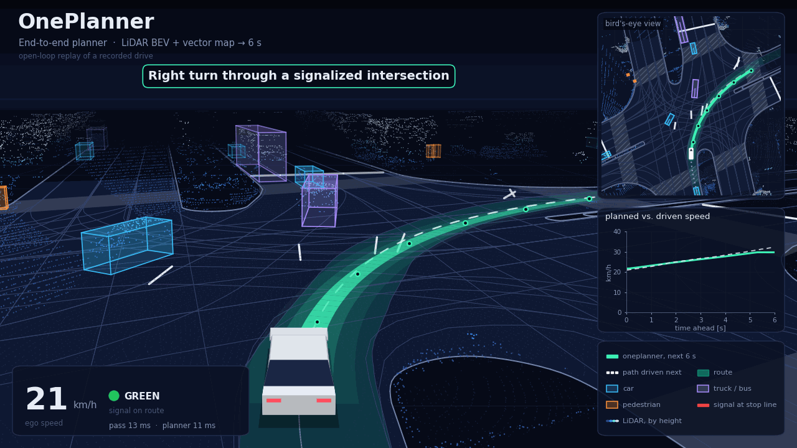
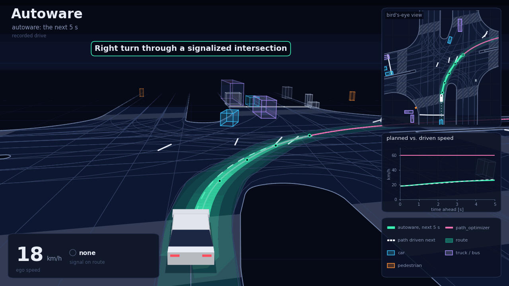
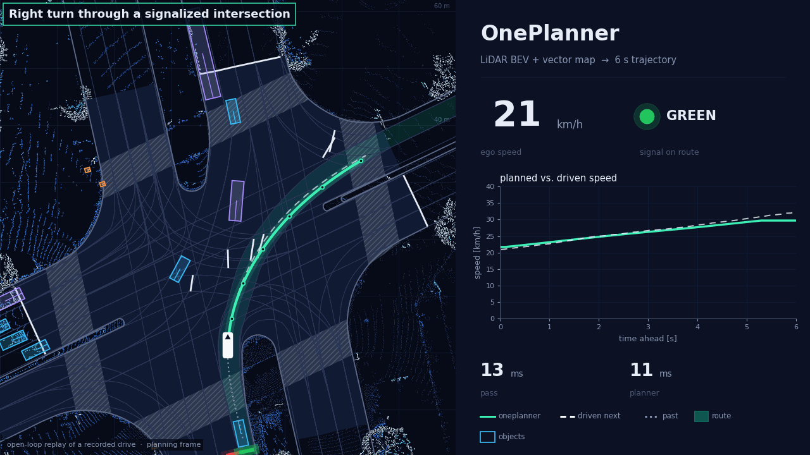

# autoware_viz

Renders a planner's trajectories over a recorded drive: chase-camera and bird's-eye frames,
animated reels of several scenes, and figures of captioned scenes. It works with any planner
that publishes `autoware_planning_msgs/Trajectory`, of any horizon, and reads its inputs live
from ROS 2 or straight from rosbag2 recordings (sqlite3 or mcap).

<p align="center">
  
</p>

Every frame is one message of the trajectory you follow, drawn in the frame it starts in
(base_link at the trajectory's stamp, the ego pose from the odometry):

- the trajectory as a ribbon with a mark every second, and any others you compare it with;
- the path the vehicle drove next (dashed) and the one it came by (dotted);
- the Lanelet2 map: lanes, crosswalks, intersection areas, stop lines and road borders, and the
  route;
- the traffic lights on their stop lines, in what they mean for the route's lane, as Autoware
  reads them: a green circle, or a green arrow for a lane turning that way;
- the point cloud, coloured by height, and the objects as boxes coloured by class;
- the planned speed against the speed driven, the ego speed, the signal on the route and the
  processing times you choose to show.

No absolute coordinate, time of day or date is drawn. The chase camera is a pinhole projection
computed with numpy and drawn back to front with matplotlib; there is no 3D engine. ffmpeg
encodes the animations.

<p align="center">
  
</p>

Above, the same turn from a recording of Autoware's own planning stack, with no point cloud:
its final trajectory, and the path optimizer's output drawn beside it for comparison.

## Install

```bash
pip install .
```

Rendering needs Python 3.8 or newer with numpy, matplotlib and Pillow, and `ffmpeg` with
`libwebp` and `libx264` for reels. Recording and extracting runs need a sourced ROS 2 workspace
with the Autoware messages (`autoware_planning_msgs`, `autoware_perception_msgs` and, for
processing times, `autoware_internal_debug_msgs`). Recording and extraction are tested with ROS 2
Humble, the rest with Python 3.10 and 3.12.

## Inputs

| Input                    | Default topic                                           | Message                                                      |
| ------------------------ | ------------------------------------------------------- | ------------------------------------------------------------ |
| `--trajectory`, required | `/planning/trajectory`                                  | `autoware_planning_msgs/Trajectory`, in `map` or `base_link` |
| `--odometry`             | `/localization/kinematic_state`                         | `nav_msgs/Odometry`                                          |
| `--cloud`                | `/sensing/lidar/concatenated/pointcloud`                | `sensor_msgs/PointCloud2`, in `base_link`                    |
| `--objects`              | `/perception/object_recognition/objects`                | `DetectedObjects`, `TrackedObjects` or `PredictedObjects`    |
| `--route`                | `/planning/mission_planning/route`                      | `autoware_planning_msgs/LaneletRoute`                        |
| `--signals`              | `/perception/traffic_light_recognition/traffic_signals` | `autoware_perception_msgs/TrafficLightGroupArray`            |
| `--timing LABEL=TOPIC`   | none                                                    | `autoware_internal_debug_msgs/Float64Stamped`, in ms         |
| `--map`                  | none                                                    | a Lanelet2 `.osm` file                                       |

Every input but the trajectory is optional; an empty topic (`--cloud ''`) leaves it out, and what
a run lacks is not drawn. `--trajectory` takes `[LABEL=]TOPIC` and can be repeated to compare
planners; the first one is followed, the others are drawn beside it. The map is read from the
`local_x` / `local_y` tags of its nodes, the map-frame coordinates that Autoware's maps carry.

## Usage

### 1. Make a run

From recordings, given in order (a route recorded only in the first one holds for the rest):

```bash
autoware-viz extract runs/drive1 bag_0 bag_1 --map lanelet2_map.osm
```

or live, while the stack runs or a recording plays, until Ctrl-C:

```bash
autoware-viz record runs/drive1 --map lanelet2_map.osm \
  --trajectory mine=/my_planner/output/trajectory \
  --trajectory autoware=/planning/scenario_planning/trajectory \
  --timing planner=/my_planner/debug/processing_time_ms
```

A run directory holds `meta.json` (which topic each input came from, and the map), one JSONL
file per input and `clouds/`, the point clouds cropped to 100 m around the ego and thinned to
the highest point of each 0.2 m cell. A minute of driving takes about 200 MB, nearly all of it
clouds.

### 2. Find scenes

```bash
autoware-viz rank runs/drive1 runs/drive2 --json scenes.json
```

prints how far the plan's position after 1, 2, 3 and 6 s is from where the vehicle drove, then
the best 8 to 12 s windows: those that turn, start, stop, run fast or see the signal change
while the plan stays close to what was driven. `scenes.json` is ready for `reel`.

### 3. Render frames

```bash
autoware-viz chase runs/drive1 out/chase --start 3.5 --end 11.5 \
  --title "Right turn on a green arrow" --header "My planner" --horizon 6
autoware-viz bev runs/drive1 out/bev --start 3.5 --end 11.5
```

`--start` and `--end` are seconds after the run's first trajectory. Each frame is
`<index>.png`, 1280 x 720 (`chase --width` for another size, `--clean` for the scene, the caption
and a speed badge only). Rendering takes about a second per frame and core.

<p align="center">
  
</p>

The options that set what is drawn are common to `chase`, `bev`, `reel` and `sheet`:

| Option                    | Sets                                                                              |
| ------------------------- | --------------------------------------------------------------------------------- |
| `--horizon S`             | Seconds of each trajectory to draw, and of the driven path and speed to compare   |
| `--plan LABEL`            | The trajectory to follow, by its label                                            |
| `--history S`             | Seconds of the path driven before, 3 by default                                   |
| `--title`                 | The scene's caption                                                               |
| `--header`, `--subheader` | Large text at the top and a line under it; `{horizon}` and `{plan}` are filled in |
| `--note`                  | Small print, e.g. "replay of a recorded drive"                                    |
| `--map`                   | Another map than the one the run was made with                                    |

### 4. Make a reel

```bash
autoware-viz reel examples/scenes.json out/reel
```

renders each scene of [examples/scenes.json](examples/scenes.json) and joins them, with short
fades, into `out/reel/reel.webp` (960 pixels wide, `--webp-width`) and `out/reel/reel.mp4`, at
10 frames per second. A scene already rendered with the same settings is reused.

### 5. Make a figure

```bash
autoware-viz sheet examples/panels.json out/scenes.png
```

draws the frame nearest each panel's time in the `--clean` style and tiles them two to a row:

<p align="center">
  
</p>

## How the inputs are read

- **Time along a trajectory** is its points' `time_from_start`. Where a planner leaves it empty,
  as Autoware's own planning stack does, it is integrated along the path from the point speeds.
  Without `--horizon` the whole trajectory is drawn, or its first 8 s when the times were
  integrated.
- **Points before the ego** are dropped, so a trajectory that starts behind the vehicle is drawn
  from the vehicle on.
- **Traffic lights** are matched to the map by their group id, the id of the regulatory element.
  Each group keeps its latest state for 1.5 s, so topics that carry only some groups per
  message are read whole.
- **The point cloud and the objects** are moved from their own stamps to the trajectory's with
  the odometry; objects may be in `map` or `base_link`, the cloud in `base_link`.

## License

Apache License 2.0, see [LICENSE](LICENSE). The demo animation and the scene figure of
[autoware_oneplanner](https://github.com/autowarefoundation/autoware_oneplanner) were rendered
with an earlier version of this tool.
